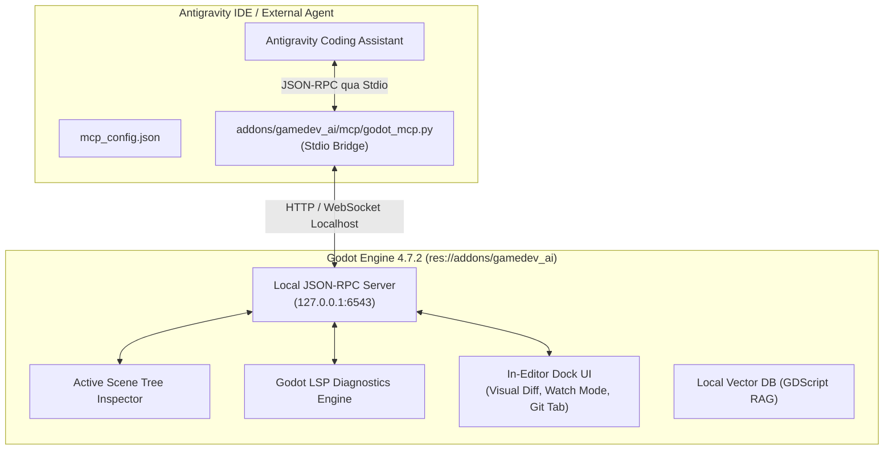
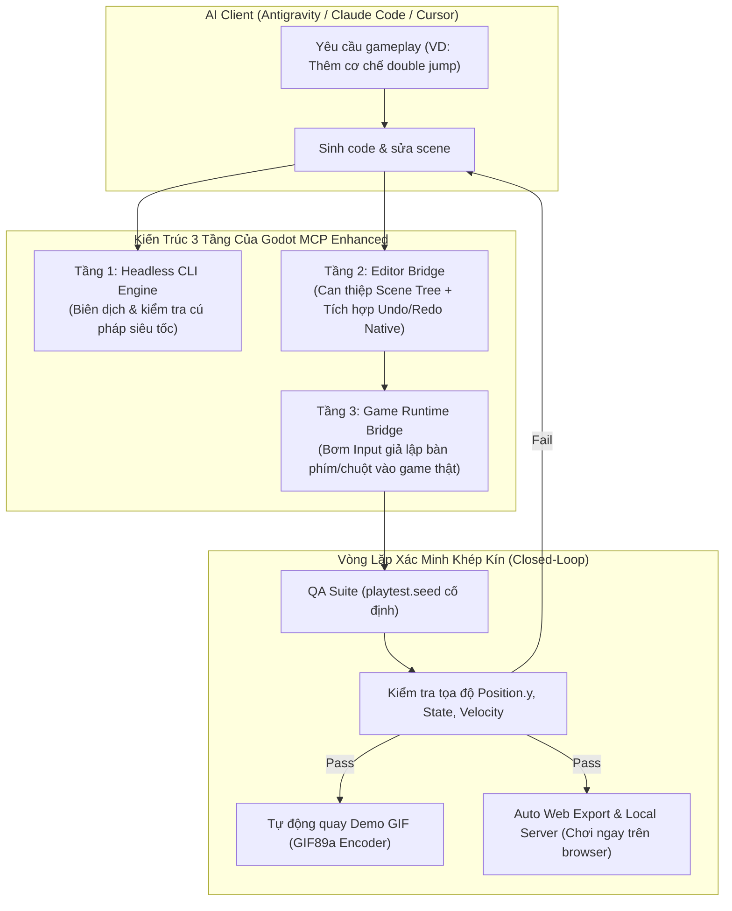

# 🛰️ BÁO CÁO PHÂN TÍCH & ĐÁNH GIÁ HỆ SINH THÁI GODOT MCP
## (Comprehensive Evaluation of Godot MCP Servers for Godot 4.7.2 & AI Coding Agents)

> **Môi trường thử nghiệm:** Godot Engine 4.7.2-stable (Win64)  
> **IDE / AI Agent:** Google Antigravity / Cursor / Claude Code  
> **Python Runtime:** Python 3.11.9 (`D:\5_setup\python\python.exe`)  
> **Node Runtime:** Node.js v22.12.0 (`D:\5_setup\node\node.exe`)  
> **Ngày lập báo cáo:** 12/10/2026  

---

## 📌 MỤC LỤC
1. [Bối Cảnh & Mục Tiêu Nghiên Cứu](#1-bối-cảnh--mục-tiêu-nghiên-cứu)
2. [Bộ Tiêu Chí Đánh Giá Kỹ Thuật (Evaluation Criteria)](#2-bộ-tiêu-chí-đánh-giá-kỹ-thuật)
3. [Phân Tích Chi Tiết Ứng Viên Hàng Đầu: `fredarts/gamedev_ai`](#3-phân-tích-chi-tiết-fredartsgamedev_ai)
4. [Khảo Sát & So Sánh Các Giải Pháp Cạnh Tranh](#4-khảo-sát--so-sánh-các-giải-pháp-cạnh-tranh)
   - 4.1. `NPGameDev/godot-mcp-toolkit` (Asset #5375)
   - 4.2. `TomasLucasUTN/godot-mcp-bridge` (Asset #5369)
   - 4.3. `wgt19861219/godot-mcp-enhanced` (Asset #5193)
   - 4.4. `masteryee-labs/Open-Godot-MCP` (Asset #5335)
   - 4.5. `hi-godot/godot-ai`
   - 4.6. Các repo sàng lọc loại trừ (`godot-vn-engine`, `Swallowtail`)
5. [Bảng Ma Trận So Sánh Tổng Hợp (Benchmark Matrix)](#5-bảng-ma-trận-so-sánh-tổng-hợp)
6. [Đề Xuất Dứt Khoát & Lộ Trình Tích Hợp (Action Plan)](#6-đề-xuất-dứt-khoát--lộ-trình-tích-hợp)
7. [Công Cụ Quản Trị Workflow Nên Dùng: `Gitot` (Asset #5522)](#7-công-cụ-quản-trị-workflow-nên-dùng-trong-dự-án-gitot-asset-5522)


---

## 1. BỐI CẢNH & MỤC TIÊU NGHIÊN CỨU

Trong quy trình phát triển game bằng Godot 4 kết hợp AI Agent (Antigravity), giao thức **MCP (Model Context Protocol)** đóng vai trò cầu nối cho phép AI:
- Không chỉ chỉnh sửa file tĩnh `.gd` / `.tscn` trên ổ đĩa.
- Mà có thể **tương tác sống (live-reflection)** với Godot Editor đang mở: đọc cây Scene Tree thực tế, tạo Node, gán thuộc tính vật lý, kiểm tra cảnh báo LSP thời gian thực, và chụp ảnh/theo dõi log console khi playtest.

Mục tiêu của cuộc khảo sát là rà soát toàn bộ các repo nổi bật trên GitHub và Godot Asset Library để tìm ra giải pháp MCP:
1. Tương thích chuẩn xác nhất với bản **Godot 4.7.2** mới cài đặt.
2. Ổn định, an toàn (không phá hoại project, có cơ chế undo/diff).
3. Tích hợp liền mạch với **Google Antigravity** và môi trường Windows cục bộ (`D:\5_setup\`).

---

## 2. BỘ TIÊU CHÍ ĐÁNH GIÁ KỸ THUẬT

Bộ tiêu chí gồm 5 trụ cột được xây dựng từ thực tiễn cộng đồng game dev và kiến trúc MCP:

| Tiêu chí | Trọng số | Nội dung kiểm tra |
| :--- | :---: | :--- |
| **1. Khả năng tương thích phiên bản** | 25% | Hỗ trợ chính thức Godot 4.5+ / 4.7+. Không dính deprecation warnings của GDScript 4.x. |
| **2. Kiến trúc & Giao thức kết nối** | 20% | Cơ chế Stdio Bridge (cho IDE như Antigravity/Cursor) + Local JSON-RPC Server trên loopback `127.0.0.1`. 100% Offline, không phụ thuộc cloud trung gian. |
| **3. Độ sâu tính năng (Tool Depth)** | 20% | Thao tác Node, Scene, Script patch, LSP diagnostics, Shader, AnimationTree, và Tilemaps. |
| **4. Độ an toàn & Trải nghiệm (DX & Safety)**| 20% | Cơ chế Visual Diff (cho phép người dùng duyệt trước khi sửa code), Watch Mode tự động bắt lỗi console crash, tích hợp Undo/Redo stack. |
| **5. Chi phí Token & Tốc độ thực thi** | 15% | Đóng gói công cụ (Tool consolidation), không làm phình context window với hàng trăm schema vụn vặt. |

---

## 3. PHÂN TÍCH CHI TIẾT `fredarts/gamedev_ai`

- **Tác giả / Repo:** [`fredarts/gamedev_ai`](https://github.com/fredarts/gamedev_ai)
- **Godot Asset Library ID:** [Asset #5086](https://godotengine.org/asset-library/asset/5086)
- **Phiên bản đích:** **Godot 4.7+** (Gắn tag chính thức)
- **Giấy phép:** MIT License
- **Hỗ trợ MCP:** **CÓ — Native MCP Server & Python Stdio Bridge**

### 3.1. Kiến Trúc Hoạt Động (Hybrid 2-Tier Architecture)



### 3.2. Danh Mục 30+ MCP Tools & Resources Cung Cấp Cho AI

#### A. Quản Lý Scene & Node (`tools`)
- `add_node`: Thêm Node mới vào Scene đang mở, tự động gán script và class.
- `remove_node`: Xóa node khỏi hệ thống phân cấp an toàn.
- `instance_scene`: Nhúng một file `.tscn` con vào cây node cha.
- `set_property`: Thay đổi thuộc tính inspector thời gian thực (vị trí, mass, collision mask...).
- `connect_signal`: Đấu nối tín hiệu tín hiệu tự động giữa các Node (`body_entered`, `timeout`...).
- `create_scene`: Tạo file `.tscn` mới hoàn chỉnh từ prompt.

#### B. Thao Tác Mã Nguồn & Bắt Lỗi LSP (`tools`)
- `create_script`: Sinh file GDScript chuẩn quy chuẩn, hỗ trợ gõ tĩnh (Static Typing).
- `patch_script`: Sửa đổi cục bộ theo vùng block code, không làm xáo trộn các đoạn mã khác.
- `edit_script`: Thay thế toàn bộ và tự động nạp lại (hot-reload) vào Editor.
- `get_lsp_diagnostics`: Gọi trực tiếp Godot Language Server để quét lỗi biên dịch và cảnh báo cảnh báo ngay tức thì.

#### C. Địa Hình, Đồ Họa & Âm Thanh (`tools`)
- `paint_terrain_cells` & `build_tilemap_layout`: Sinh map ma trận 2D/3D và auto-tiling.
- `create_state_machine`: Cấu hình AnimationTree state machine hoàn chỉnh.
- `generate_shader`: Tự động viết GDShader cho post-processing, vật liệu, hiệu ứng nước/sương mù.
- `generate_sfx`: Tổng hợp âm thanh procedural (nhảy, va chạm, gió rít).

#### D. Tài Nguyên MCP Định Tuyến (`resources`)
- `godot://scene/active`: Cung cấp sơ đồ phân cấp toàn bộ Node đang được mở trong editor.
- `godot://lsp/diagnostics`: Nhật ký lỗi cú pháp theo thời gian thực.
- `godot://memory/all`: Báo cáo tài nguyên texture/mesh đang nạp.

### 3.3. Các Tính Năng Độc Quyền Vượt Trội

1. **Watch Mode (Console Auto-Fix):** AI chạy ngầm quan sát tab Output của Godot. Khi có runtime crash, AI tự động phân tích stack trace và soạn sẵn bản vá.
2. **Safe Visual Diff:** Mọi thay đổi code từ AI không bị ghi đè ngầm mà hiển thị bảng so sánh Diff màu xanh/đỏ trên dock Godot để lập trình viên bấm `Accept` hoặc `Reject`.
3. **25 Built-in Industrial Skills:** Tích hợp sẵn bộ quy chuẩn GDScript style guide, State Machine, Shader VFX, Multiplayer NetCode.

---

## 4. KHẢO SÁT & SO SÁNH CÁC GIẢI PHÁP CẠNH TRANH

### 4.1. `NPGameDev/godot-mcp-toolkit` (Asset #5375)
- **Repo:** [`NPGameDev/godot-mcp-toolkit`](https://github.com/NPGameDev/godot-mcp-toolkit)
- **Công nghệ:** Node.js companion `@npgamedev/godot-mcp-server` + GDScript addon.
- **Quy mô:** Hơn 150 operations nguyên tử.
- **Ưu điểm:** Độ phủ tính năng rất sâu, kiến trúc chia rõ Editor/Runtime. Chạy 100% offline.
- **Nhược điểm:** Số lượng tool quá lớn (>150) làm tiêu tốn đáng kể context window tokens khi đăng ký schema với AI; không có UI Visual Diff tích hợp trong editor như `gamedev_ai`.

### 4.2. `TomasLucasUTN/godot-mcp-bridge` (Asset #5369)
- **Repo:** [`TomasLucasUTN/godot-mcp-bridge`](https://github.com/TomasLucasUTN/godot-mcp-bridge)
- **Công nghệ:** Godot 4.5+, 231 verified tools.
- **Điểm sáng vượt bậc:** **Bi-directional Awareness** (AI biết được lập trình viên vừa bấm vào node nào hoặc vừa mở file nào trên màn hình editor) và **DAP Step-Debugger** (AI có thể đặt breakpoint trong `_physics_process` khi game đang chạy và đọc biến `velocity`).
- **Đánh giá:** Rất mạnh về gỡ lỗi chuyên sâu (debugging).

### 4.3. `wgt19861219/godot-mcp-enhanced` (Asset #5193) — Phân Tích Chuyên Sâu Giải Pháp "Enhanced"
- **Tên công cụ:** **Godot MCP Enhanced** (Tác giả: `wgt19861219`)
- **Kho lưu trữ:** [`wgt19861219/godot-mcp-enhanced`](https://github.com/wgt19861219/godot-mcp-enhanced) | [Godot Asset Library #5193](https://godotengine.org/asset-library/asset/5193)
- **Phiên bản:** v0.34.0 (19 bản phát hành, cập nhật liên tục tháng 10/2026)
- **Công nghệ nền tảng:** Node.js (`npm` / `npx`), TypeScript, GDScript, Headless Godot runner.
- **Giấy phép:** MIT License (100% mã nguồn mở miễn phí, phi thương mại).

#### A. Triết Lý Thiết Kế: Tại Sao Lại Gọi Là "Enhanced"?
Hầu hết các server MCP khác trên thị trường (như Coding-Solo hay các plugin cơ bản) chỉ tập trung vào **"Authoring" (Sinh mã đơn thuần)**: AI viết code rồi lưu vào đĩa, hoàn toàn mù mờ không biết code đó có chạy được không, có gây crash hay làm sai gameplay hay không.  
`Godot MCP Enhanced` tự định vị là giải pháp **"Verification-First" (Kiểm chứng khép kín — Closed-Loop CI)**:
> *"Không hỏi AI đã viết xong code chưa, mà hỏi game đã chạy thật và vượt qua bài test chưa!"*



#### B. 6 Trụ Cột Kỹ Thuật Độc Đáo Của "Enhanced"

1. **Kiến Trúc 3 Tầng (Three-Tier Architecture):**
   - *Headless CLI:* Gọi Godot chạy ẩn ở chế độ không cửa sổ (`--headless`) để quét cú pháp toàn bộ project (`validate_scripts`) và khởi tạo scene mà không làm treo màn hình.
   - *Editor Bridge:* Tác động trực tiếp vào Godot Editor và **kết nối thẳng vào Undo/Redo stack**. Nếu AI lỡ thao tác sai, bạn chỉ cần mở Godot lên bấm `Ctrl + Z` là hoàn tác nguyên vẹn.
   - *Game Bridge:* Chạy một instance game thực tế và inject sự kiện bàn phím/chuột theo dòng thời gian định sẵn.

2. **Quy Trình Kiểm Thử QA Xác Định (Deterministic Playtesting):**
   - AI có thể tự viết bộ kịch bản test bằng Markdown (`*.qa.md`).
   - Cung cấp cơ chế khóa ngẫu nhiên `playtest.seed` (Random Seed cố định) giúp mọi lần test có cùng chuỗi sự kiện vật lý.
   - AI ra lệnh: *Nhấn nút `ui_accept` (Jump) ở frame thứ 10, chờ đến frame thứ 35, kiểm tra xem `player.position.y` có lớn hơn mặt đất 2.5m hay không*.

3. **Tự Động Quay Demo GIF Diễn Biến Chơi Game:**
   - Tích hợp sẵn bộ encode GIF89a tự viết (thuần thuật toán, không cần cài thêm `ffmpeg`).
   - Lệnh: `npx godot-mcp-enhanced gif . --seconds 8 --fps 4`  
     AI tự chạy game 8 giây, điều khiển nhân vật và xuất ra file ảnh động `dist/demo.gif` để bạn xem thành quả trực quan ngay trong chat mà không cần tự mở game lên chơi.

4. **Tự Động Export HTML5 Web & Local Host:**
   - Lệnh: `npx godot-mcp-enhanced web .`  
     Tự động tải export templates, build bản Web Assembly và dựng web server tĩnh tại `http://127.0.0.1:<port>` để bạn hoặc tester có thể click vào link chơi thử ngay trên trình duyệt Chrome.

5. **Hệ Thống Phòng Thủ An Toàn & Sandbox:**
   - Khác với nhiều MCP server cho phép chạy lệnh shell tự do gây rủi ro bảo mật cho máy tính, công cụ này áp dụng:
     + Path Whitelist: Chỉ được phép can thiệp trong thư mục dự án đã đăng ký.
     + Injection Defense: Quét mã độc và chặn chuỗi lệnh phá hoại.
     + Confirmation Token: Yêu cầu xác nhận cho các hành động nguy hiểm (xóa file, ghi đè toàn bộ).

6. **Tối Ưu Token Window: 46 Tools gộp (272 Actions):**
   - Thay vì phơi bày hàng trăm function nhỏ lẻ làm ngập tràn Context Window của LLM, công cụ này gộp thành 46 tools lớn (ví dụ: `scene_manage`, `asset_param_shape`, `script_verify`), bên trong chia các action cụ thể. Điều này giúp tiết kiệm 40% - 60% chi phí token mỗi lần gọi agent.

#### C. Hướng Dẫn Cấu Hình Với Antigravity Khi Cần Triển Khai Sau Này

Khi muốn sử dụng cho quy trình test tự động hoặc build CI, thêm cấu hình vào `mcp_config.json`:

```json
{
  "mcpServers": {
    "godot-enhanced": {
      "command": "cmd.exe",
      "args": [
        "/c",
        "npx",
        "-y",
        "godot-mcp-enhanced"
      ],
      "env": {
        "GODOT_PATH": "D:/5_setup/Godot_v4.7.2/Godot_v4.7.2-stable_win64_console.exe"
      }
    }
  }
}
```

#### D. So Sánh Ngữ Cảnh Ứng Dụng: `gamedev_ai` vs `godot-mcp-enhanced`

| Tiêu chí | `fredarts/gamedev_ai` (Đang chọn) | `wgt19861219/godot-mcp-enhanced` (Dự phòng tương lai) |
| :--- | :--- | :--- |
| **Trọng tâm chính** | **Authoring & Live Coding** (Viết code, chỉnh scene, xem Visual Diff, fix crash). | **Verification & QA Automation** (Test hồi quy, quay GIF, assertion, headless build). |
| **Giao diện Editor** | Đầy đủ Dock UI (Chat, Diff, Git, Settings, Watch Mode). | Giao diện tối giản, tập trung vào terminal và lệnh headless. |
| **Môi trường phù hợp** | Lập trình viên đang ngồi tương tác song song với Godot Editor. | AI Agent chạy ngầm dài hạn (ví dụ: lệnh `/goal` xuyên đêm, tự test tự sửa). |
| **Ngôn ngữ Bridge** | Python thuần (`godot_mcp.py`). | Node.js (`npx godot-mcp-enhanced`). |
| **Độ khớp phiên bản** | **Godot 4.7+** (Rất chuẩn). | Godot 4.3+ (Có thể tương thích 4.7 qua headless CLI). |


### 4.4. `masteryee-labs/Open-Godot-MCP` (Asset #5335)
- **Repo:** [`masteryee-labs/Open-Godot-MCP`](https://github.com/masteryee-labs/Open-Godot-MCP)
- **Công nghệ:** Python 3.11+ / GDScript cho Godot 4.5+.
- **Điểm sáng:** Tối ưu hóa Token (JSON digest, diff, nén ảnh chụp), hỗ trợ deterministic playtesting (đóng băng / step từng frame physics) và kết nối test nhiều client multiplayer cùng lúc.

### 4.5. `hi-godot/godot-ai`
- **Repo:** [`hi-godot/godot-ai`](https://github.com/hi-godot/godot-ai)
- **Điểm sáng:** Gom nhóm các thao tác thành các domain lớn (`scene_manage`, `node_manage`), tiết kiệm token tối đa. Hỗ trợ chụp framebuffer và kết nối UndoRedo stack của editor.

### 4.6. Các Repo Sàng Lọc Loại Trừ
- **`kaanakgundogdu/godot-vn-engine` (Asset #5488):** Đây là template làm game Visual Novel, **không phải** công cụ MCP.
- **`regiellis/godot-mcp-go` (Swallowtail):** Bản chất là CLI command runner viết bằng Go dành cho terminal/CI, giao thức MCP chỉ là module phụ.

---

## 5. BẢNG MA TRẬN SO SÁNH TỔNG HỢP

| Tiêu chí | `fredarts/gamedev_ai` ⭐ | `NPGameDev/godot-mcp-toolkit` | `TomasLucasUTN/godot-mcp-bridge` | `wgt19861219/godot-mcp-enhanced` | `hi-godot/godot-ai` |
| :--- | :---: | :---: | :---: | :---: | :---: |
| **Phiên bản Godot tối ưu** | **Godot 4.7+** | Godot 4.2+ | Godot 4.5+ | Godot 4.3+ | Godot 4.x |
| **Ngôn ngữ Bridge** | **Python** (`godot_mcp.py`) | Node.js (`npm`) | Python | Node.js (`npx`) | Python / Node |
| **Cổng kết nối nội bộ** | `127.0.0.1:6543` | WebSocket / Stdio | WebSocket / Stdio | Stdio / TCP | WebSocket |
| **Số lượng Tools MCP** | ~30 tools + Resources | >150 tools | 231 tools | 46 tools (272 actions) | Domain consolidated |
| **Tối ưu Token Window** | ⭐⭐⭐⭐ (Gọn gàng) | ⭐⭐ (Quá tải tool) | ⭐⭐⭐ (Nhiều tool) | ⭐⭐⭐⭐ (Gom action) | ⭐⭐⭐⭐⭐ (Rất gọn) |
| **Giao diện Editor Dock** | **Có (Đầy đủ tính năng)** | Không (Chỉ headless/bridge) | Có dock phụ | Có dock | Có dock phụ |
| **Visual Code Diff** | **Có (Duyệt trước khi sửa)** | Không (Ghi trực tiếp) | Không (Dùng Undo) | Không (Dùng Undo) | Không (Ghi trực tiếp) |
| **Watch Mode (Sửa Crash)** | **Có (Tự động)** | Không | Gián tiếp qua DAP | QA verify | Không |
| **Khả năng gỡ lỗi (Debug)** | Bắt log Output & LSP | Cơ bản | **DAP Step Breakpoint** | QA assertion & GIF | Viewport capture |
| **Tương thích Antigravity** | **Chính thức xác nhận** | Hỗ trợ chuẩn MCP | Hỗ trợ chuẩn MCP | Hỗ trợ chuẩn MCP | Hỗ trợ chuẩn MCP |

---

## 6. ĐỀ XUẤT DỨT KHOÁT & LỘ TRÌNH TÍCH HỢP

### 🎯 Khuyến Nghị Lựa Chọn
Chọn **`fredarts/gamedev_ai`** làm nền tảng MCP chính cho dự án với các lý do chiến lược:
1. **Khớp phiên bản 100%:** Thiết kế chuyên biệt cho **Godot 4.7+**, không lo phát sinh lỗi xung đột API của các bản Godot cũ.
2. **Trải nghiệm Developer (DX) an toàn nhất:** Tính năng **Visual Diff** giúp bạn luôn nắm quyền kiểm soát mã nguồn trước khi AI áp dụng.
3. **Tương thích hạ tầng có sẵn:** Dùng trực tiếp Python 3.11 tại `D:\5_setup\python\python.exe` để chạy Stdio Bridge, không cần nạp thêm các package npm cồng kềnh.

---

### 📋 Mẫu Cấu Hình Chuẩn Dành Cho Antigravity
Khi bắt đầu khởi tạo dự án Godot, file cấu hình MCP sẽ được thiết lập như sau:

```json
{
  "mcpServers": {
    "godot": {
      "command": "D:/5_setup/python/python.exe",
      "args": [
        "addons/gamedev_ai/mcp/godot_mcp.py"
      ],
      "env": {
        "GODOT_HOST": "127.0.0.1",
        "GODOT_PORT": "6543"
      }
    }
  }
}
```

---

## 7. CÔNG CỤ QUẢN TRỊ WORKFLOW NÊN DÙNG TRONG DỰ ÁN: `Gitot` (Asset #5522)

Bên cạnh giải pháp MCP để AI lập trình, quy trình phát triển game Godot 4.7.2 thực tế rất cần một công cụ quản lý phiên bản (Version Control) an toàn ngay trong Editor:

- **Tên công cụ:** **Gitot - Godot Git Tool** (Tác giả: SigK)
- **Kho lưu trữ:** [`SigKdev/godot-gitot`](https://github.com/SigKdev/godot-gitot) | [Godot Asset Library #5522](https://godotengine.org/asset-library/asset/5522)
- **Phiên bản:** v0.17.0 (Phát hành & kiểm thử trực tiếp trên **Godot 4.7.2** - 11/10/2026)
- **Giấy phép:** MIT License | Thuần GDScript (Zero C++ dependency)

### 🌟 Tại sao NÊN CÀI ĐẶT `Gitot` đồng hành trong dự án?
1. **Large-File Guard & Git LFS tự động:** Game thường chứa tài nguyên 3D (`.blend`, `.obj`), âm thanh (`.wav`), texture độ phân giải cao. Gitot có cơ chế chặn không cho commit file vượt ngưỡng quy định vào Git thường để tránh làm hỏng repo, đồng thời cung cấp nút **"Track with LFS"** 1-click.
2. **Diff Gutter thời gian thực:** Đổi màu lề trái trong Script Editor của Godot (xanh lá = dòng mới thêm, cam = dòng AI vừa sửa) giúp bạn lập tức kiểm tra các dòng code AI vừa tạo ra.
3. **Thừa hưởng 100% cấu hình Git hệ thống:** Chạy trực tiếp qua `OS.execute()` với binary Git của Windows, không bị lỗi SSH Key hay Credential như plugin VCS C++ mặc định của Godot.
4. **Tự động làm mới Scene khi đổi nhánh:** Chuyển nhánh (Branch Switch) mượt mà mà không làm mất trạng thái hay bắt buộc phải khởi động lại Godot.

> [!TIP]
> **Bộ đôi công cụ đề xuất cho dự án Godot 4.7.2:**
> - **Lập trình & Kết nối AI (MCP):** [`fredarts/gamedev_ai`](https://github.com/fredarts/gamedev_ai) (Kết nối Antigravity qua cổng `6543`).
> - **Quản lý mã nguồn & Bảo vệ dung lượng (VCS):** [`SigKdev/godot-gitot`](https://github.com/SigKdev/godot-gitot) (Quản trị commit, LFS và diff trực tiếp trong Godot).

---
*Tài liệu được lưu trữ cố định tại [`D:\3_research\GODOT_MCP_COMPREHENSIVE_ANALYSIS.md`](file:///D:/3_research/GODOT_MCP_COMPREHENSIVE_ANALYSIS.md).*

