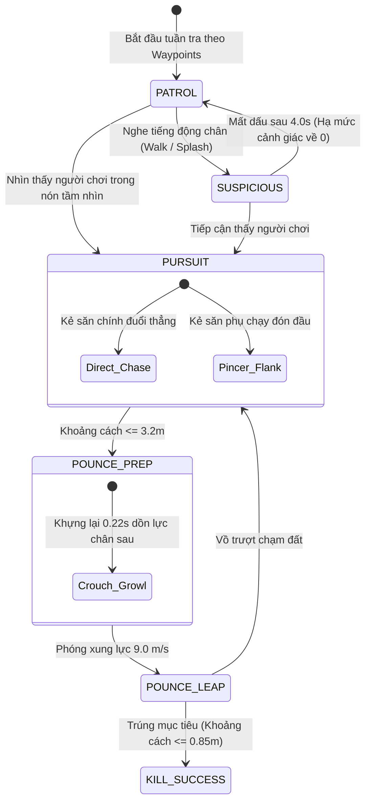
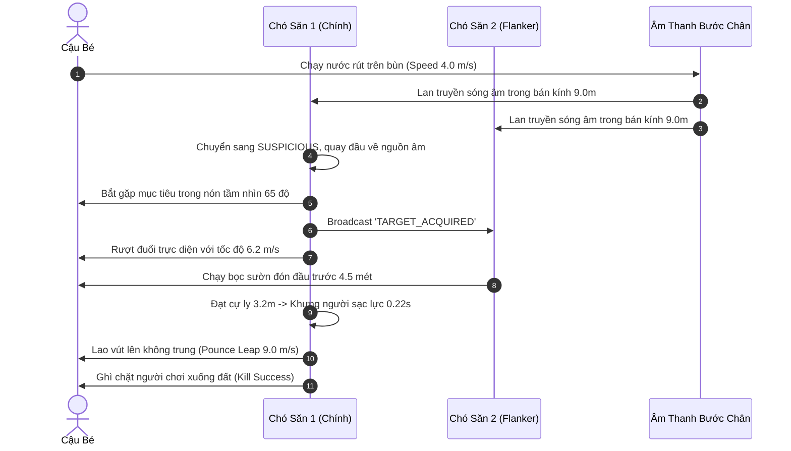
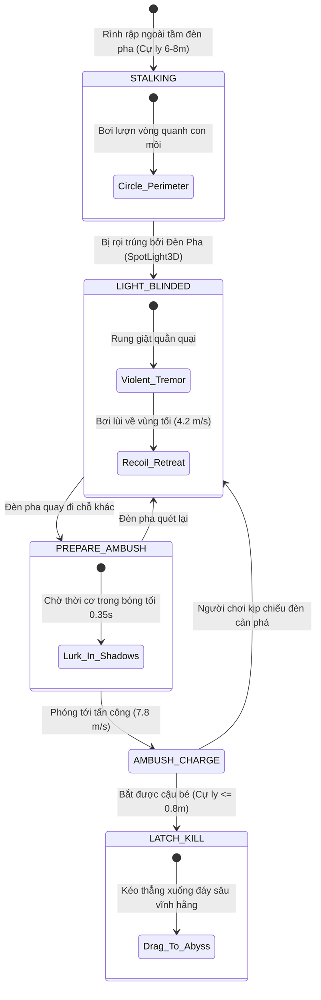
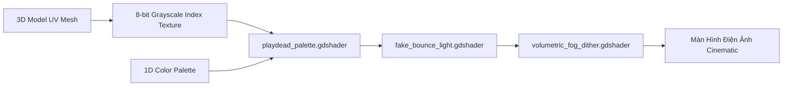

# 🏛️ CẨM NANG HỆ THỐNG CHUYÊN SÂU NÂNG CAO GAME INSIDE
## (INSIDE ADVANCED SYSTEMS & ARCHITECTURE MASTER BIBLE)

**Game gốc:** *INSIDE* (Playdead)  
**Tái hiện trên:** Godot Engine 4.x  

> ⚠️ **Đọc trước:** Tài liệu này mô tả **thiết kế của toolkit** (cách các script trong repo này hoạt động), **không phải** mã nguồn hay số liệu gốc của Playdead.
> - Tên class gốc ghi ở đầu mỗi module (ví dụ `ChaserBase`, `HuddleFootProbe`) là tên đã quan sát thấy trong file game (🔍). Chúng chỉ là nguồn cảm hứng; logic bên trong **chưa được giải mã**.
> - Mọi công thức và con số là **giá trị thiết kế của toolkit** (⚪ ước lượng để gần với cảm giác chơi), khớp với giá trị mặc định `@export` trong script. Khi số liệu trong tài liệu và trong code khác nhau, **code là chuẩn**.
> - Thang mức độ bằng chứng (✅ / 🔍 / 🟡 / ⚪) được định nghĩa trong [repo nghiên cứu](https://github.com/vietanhvu225/inside-engine-deconstruction/blob/HEAD/README.vi.md#-trạng-thái-xác-minh).

**Các file mã nguồn tương ứng:**
- [`dog_guard_ai_25d.gd`](../scripts/ai/dog_guard_ai_25d.gd) — AI Giác quan, Tầm nhìn hình nón & Bầy đàn Pincer Steering.
- [`procedural_ik_and_stumble.gd`](../scripts/player/procedural_ik_and_stumble.gd) — Hoạt ảnh thích ứng địa hình Foot/Hand IK & Vật lý vấp ngã Stumble.
- [`water_creature_and_light.gd`](../scripts/ai/water_creature_and_light.gd) — Động học bơi lội chuỗi xương & Máy trạng thái né ánh sáng đèn pha.
- [`playdead_palette.gdshader`](../shaders/playdead_palette.gdshader) — Bộ Shader Color Lookup Table ánh xạ ảnh xám 8-bit sang bảng Palette 1D.
- [`fake_bounce_light.gdshader`](../shaders/fake_bounce_light.gdshader) — Giả lập ánh sáng hắt ngược từ mặt sàn (Ground Bounce Light).
- [`volumetric_fog_dither.gdshader`](../shaders/volumetric_fog_dither.gdshader) — Sương mù thể tích kèm ma trận Bayer 4x4 khử sọc màu (Color Banding).
- [`huddle_softbody_controller.gd`](../scripts/physics/huddle_softbody_controller.gd) — Động lực học khối thịt mềm (Soft-body) & dịch chuyển tâm khối lượng.
- [`cinematic_camera_trigger.gd`](../scripts/camera/cinematic_camera_trigger.gd) — Vùng kích hoạt khung hình điện ảnh (Camera Blend Box).
- [`level_streaming_manager.gd`](../scripts/systems/level_streaming_manager.gd) — Quản lý nạp ngầm thế giới liền mạch không màn hình chờ (Zero Loading Screens).

---

## MỤC LỤC CHUYÊN SÂU
1. [MODULE 1: AI Giác Quan & Bầy Đàn (Dog & Guard AI Steering)](#module-1-ai-giác-quan--bầy-đàn-dog--guard-ai-steering)
2. [MODULE 2: Hoạt Ảnh Thủ Tục & Thích Ứng IK (Procedural IK & Stumble)](#module-2-hoạt-ảnh-thủ-tục--thích-ứng-ik-procedural-ik--stumble)
3. [MODULE 3: Thủy Quái & Tương Tác Ánh Sáng (Water Creature & Light Repellent)](#module-3-thủy-quái--tương-tác-ánh-sáng-water-creature--light-repellent)
4. [MODULE 4: Bộ Shader Đồ Họa Độc Quyền (The Playdead Look Shaders)](#module-4-bộ-shader-đồ-họa-độc-quyền-the-playdead-look-shaders)
5. [MODULE 5: Vật Lý Quái Thể Khổng Lồ (The Huddle Soft-Body Mechanics)](#module-5-vật-lý-quái-thể-khổng-lồ-the-huddle-soft-body-mechanics)
6. [MODULE 6: Camera Điện Ảnh & Nạp Màn Chơi Liền Mạch (Cinematics & Streaming)](#module-6-camera-điện-ảnh--nạp-màn-chơi-liền-mạch-cinematics--streaming)

---

## MODULE 1: AI GIÁC QUAN & BẦY ĐÀN (DOG & GUARD AI STEERING)

Lấy cảm hứng từ các class quan sát được trong game (🔍): `ChaserBase`, `ChaserDudeDroppableFlashLight`, `DogChaseDistCompare`, `HulvBark`. Toàn bộ mô hình bên dưới là thiết kế của toolkit (⚪).

### 1. Mô hình Toán học Giác quan
1. **Nón Tầm nhìn 3D (Vision Cone):**  
   Một điểm mục tiêu $P_{target}$ nằm trong tầm nhìn khi thỏa mãn đồng thời 3 điều kiện:
   $$\|P_{target} - P_{AI}\| \le R_{vision}$$
   $$\frac{(P_{target} - P_{AI}) \cdot \vec{F}_{forward}}{\|P_{target} - P_{AI}\|} \ge \cos(\theta_{half})$$
   $$\text{RaycastOcclusion}(P_{AI} + \vec{h}_{eye}, P_{target}) = \text{Clear}$$
   Trong đó:
   - $R_{vision} = 14.0\text{m}$ khi có đèn pin / ánh sáng ban ngày; $4.0\text{m}$ trong bóng tối.
   - $\theta_{half} = 65.0^\circ$ (góc quét rộng $130^\circ$).
2. **Bán kính Lan truyền Âm thanh (Sound Propagation Radius):**
   - Đi bộ: $R_{hear} = 3.5\text{m}$
   - Chạy nước rút (Sprint): $R_{hear} = 9.0\text{m}$
   - Vùng vẫy dưới nước (Water Splash): $R_{hear} = 13.0\text{m}$
3. **Thuật toán Kẹp góc Bầy đàn (Pincer Steering):**  
   Khi có 2 chó săn hoặc lính gác cùng truy kích, AI phụ (Flanker) không chạy thẳng về phía người chơi mà tính toán vị trí chặn đầu (Intercept Prediction):
   $$X_{intercept} = X_{player} + \text{sign}(V_{player.x}) \times D_{flank}$$
   với $D_{flank} = 4.5\text{m}$.

### 2. Sơ đồ Máy trạng thái AI (State Diagram)

### 3. Sơ đồ Tuần tự Săn mồi Bầy đàn (Sequence Diagram)

---

## MODULE 2: HOẠT ẢNH THỦ TỤC & THÍCH ỨNG IK (PROCEDURAL IK & STUMBLE)

Lấy cảm hứng từ các class quan sát được (🔍): `HuddleFootProbe`, `BoyReachPlateauState`, `FallUtils`. Thuật toán bên dưới là thiết kế của toolkit (⚪).

### 1. Thuật toán Foot IK (Bám bậc thang & Dốc nghiêng)
- Bắn 2 tia Raycast từ hông xuống:
  $$Y_{target.L} = \text{Raycast}(P_{hip} + \vec{x}_{-offset}, \vec{down}).y + H_{sole}$$
  $$Y_{target.R} = \text{Raycast}(P_{hip} + \vec{x}_{+offset}, \vec{down}).y + H_{sole}$$
- Nội suy mượt mà qua hàm LERP:
  $$Y_{foot}(t) = \text{lerp}(Y_{foot}(t - \Delta t), Y_{target}, \alpha_{ik} \Delta t)$$
  với $\alpha_{ik} = 16.0$, đảm bảo bàn chân bám dính tự nhiên lên từng bậc thang mà không có độ trễ giật.

### 2. Thuật toán Hand-Snapping (Hít vách tường & Mép hộp)
- Khi nhân vật chạy sát tường ($\le 0.85\text{m}$), tia raycast ngang từ ngực phát hiện mặt phẳng va chạm:
  $$P_{palm} = P_{hit} + \vec{N}_{surface} \times 0.04\text{m}$$
  Bàn tay nhân vật tự động duỗi ra đặt lên tường, tạo cảm giác nhân vật cảm nhận được môi trường xung quanh.

### 3. Động lực học Rơi ngã & Loạng choạng (Stumble Dynamics)
- Ngưỡng vận tốc tiếp đất $V_y$:
  - $V_y > -10.5\text{m/s}$: Tiếp đất êm dịu, không gián đoạn chuyển động.
  - $-17.5\text{m/s} \le V_y \le -10.5\text{m/s}$: **Loạng choạng (Stumble)**. Khóa điều khiển $0.48\text{s}$, vận tốc ngang bị triệt tiêu với gia tốc hãm $18\text{m/s}^2$, nhân vật khuỵu gối chống tay.
  - $V_y < -17.5\text{m/s}$: **Tử vong (Fatal Fall)**. Xương gãy, kích hoạt Ragdoll buông thõng.

---

## MODULE 3: THỦY QUÁI & TƯƠNG TÁC ÁNH SÁNG (WATER CREATURE & LIGHT REPELLENT)

Lấy cảm hứng từ các class quan sát được (🔍): `WaterGirl`, `VisualWaterGirl`, `UnderwaterCoil`, `RopesAndWaterGirlCamController`. Mô hình bên dưới là thiết kế của toolkit (⚪).

### 1. Động học Bơi lượn Chuỗi Xương (Verlet Spine Undulation)
Thân thủy quái gồm $N = 8$ đốt liên kết. Đốt đầu tiên dao động điều hòa:
$$Y_{head}(t) = Y_{base} + A \sin(\omega t)$$
với $A = 0.35\text{m}$, $\omega = 4.5\text{Hz}$.
Các đốt kế tiếp tuân thủ ràng buộc khoảng cách cố định (Distance Constraint):
$$P_{i} = P_{i-1} + \frac{P_{i} - P_{i-1}}{\|P_{i} - P_{i-1}\|} \times L_{segment}$$
với $L_{segment} = 0.32\text{m}$, tạo nên chuyển động uốn éo như lươn/rắn biển cực kỳ sống động.

### 2. Sơ đồ Máy trạng thái Xung đột Ánh sáng (State Diagram)

---

## MODULE 4: BỘ SHADER ĐỒ HỌA ĐỘC QUYỀN (THE PLAYDEAD LOOK SHADERS)

Các texture xuất từ game có dạng ảnh index 8-bit đi kèm palette 1D (🔍, xem tên file `*_8bit_index.png` / `*_8bit_palette.png` trong thư mục asset đã xuất, không có trong repo). Từ đó suy ra INSIDE có thể tô màu bằng cách tra palette (⚪); toolkit tái hiện ý tưởng này bằng pipeline shader dưới đây.

1. **`playdead_palette.gdshader`:**  
   Lấy giá trị xám $R \in [0.0, 1.0]$ làm tọa độ $U$ để tra cứu màu từ `palette_texture`. Kỹ thuật này giúp nghệ sĩ đổi toàn bộ không khí màu sắc của màn chơi chỉ bằng việc thay đổi 1 texture dải màu 256x1 pixel!
2. **`fake_bounce_light.gdshader`:**  
   Tạo ánh sáng hắt từ mặt đất:
   $$I_{bounce} = \max(-\vec{N}_{world} \cdot \vec{Y}, 0.0)^{1.2} \times C_{ground} \times 0.65$$
   Giúp phần thân dưới của nhân vật không bị đen sì mà luôn có màu xanh rêu của bùn đất hắt lên.
3. **`volumetric_fog_dither.gdshader`:**  
   Sử dụng ma trận Bayer 4x4 để cộng nhiễu giả lập vào gradient sương mù, giảm rõ rệt hiện tượng vệt màu sọc (banding) trên gradient tối.

---

## MODULE 5: VẬT LÝ QUÁI THỂ KHỔNG LỒ (THE HUDDLE SOFT-BODY MECHANICS)

Lấy cảm hứng từ các class quan sát được (🔍): `Huddle`, `AudioHuddleRoll`, `FakeSpring`, `FloatMatrixHuddleStatus`. Mô hình vật lý bên dưới là thiết kế của toolkit (⚪).

### 1. Động lực học Lăn Quán tính Cao (High-Inertia Rolling)
- Khối lượng $M = 480\text{kg}$.
- **Dịch chuyển Tâm khối lượng (Center of Mass Shift):**  
  Khi người chơi nhấn Trái/Phải ($Input_x$):
  $$CoM_x = Input_x \times 0.45\text{m}$$
  Tâm khối lượng lệch hẳn về phía trước tạo mô-men tự quay (self-torque) khổng lồ:
  $$\tau_z = -Input_x \times 6200\text{N}\cdot\text{m}$$
  khiến khối thịt nặng nề lăn tròn trên sàn nhà với quán tính đầm chắc.

### 2. Mạng lưới Lò xo Biến dạng Mềm (Soft-Body Springs)
- 12 nút lò xo phân bổ xuyên tâm quanh lõi:
  $$\vec{F}_i = -k (\vec{P}_i - \vec{P}_{rest}) - c \vec{V}_i$$
  với $k = 240\text{N/m}$, $c = 14\text{N}\cdot\text{s/m}$. Khối thịt co giãn, méo mó khi va chạm gờ tường hoặc rơi từ trên cao.

### 3. Động năng Phá hủy (Wall Smashing Threshold)
- Khi va chạm vật thể có tag `destructible_wall`:
  $$E_k = \frac{1}{2} M V_{impact}^2 \ge 2600\text{Joules}$$
  Khối thịt sẽ húc bay tường bê tông, tạo hiệu ứng vỡ vụn và rung chấn màn hình dữ dội.

---

## MODULE 6: CAMERA ĐIỆN ẢNH & NẠP MÀN CHƠI LIỀN MẠCH (CINEMATICS & STREAMING)

Lấy cảm hứng từ các tên quan sát được (🔍): `Camera Blend Box`, `EndLockCameraPivot`, `SubsceneBounds`, `UnloadInactiveSubscenes`. Cơ chế bên dưới là thiết kế của toolkit (⚪).

### 1. Camera Framing Triggers (`cinematic_camera_trigger.gd`)
- Khi nhân vật bước vào trigger box, camera tự động chuyển đổi phối cảnh:
  - Mặc định trong script: FOV $32^\circ$, cự ly Z $14\text{m}$, thời gian chuyển $1.8\text{s}$. Mỗi trigger box tự đặt giá trị riêng, ví dụ:
  - **Phòng hẹp:** FOV khoảng $22^\circ$, cự ly Z khoảng $10\text{m}$.
  - **Đại cảnh nhà máy / rừng:** FOV khoảng $42^\circ$, cự ly Z khoảng $22\text{m}$.
  - **Khóa trục (Stationary Shot):** Khóa tạm thời tọa độ X/Y để tạo góc máy tĩnh điện ảnh khi nhân vật giải đố.

### 2. Quản lý Màn chơi Liền mạch (Seamless Streaming)
- Theo các tên `SubsceneBounds` / `UnloadInactiveSubscenes` (🔍), INSIDE có vẻ chia bản đồ thành các subscene. Toolkit chia màn chơi thành các subscene dọc trục X:
  - Cự ly nạp trước: $D_{preload} = 35.0\text{m}$. Khi người chơi còn cách subscene kế tiếp 35m, hệ thống dùng `ResourceLoader.load_threaded_request()` để nạp ngầm đa luồng.
  - Cự ly giải phóng: $D_{unload} = 55.0\text{m}$. Khi người chơi đã đi qua và vượt xa 55m, subscene cũ tự động `queue_free()`.
- Mục tiêu: chuyển vùng liền mạch, không có màn hình loading. *(Chưa có số liệu đo hiệu năng hay bộ nhớ.)*

---

## 🎯 TÌNH TRẠNG

Cả 6 module đã có script và shader tương ứng trong repo (mức prototype). Các con số ở đây là giá trị thiết kế của toolkit, có thể chỉnh trong Inspector. Khi có số liệu xác minh từ [repo nghiên cứu](https://github.com/vietanhvu225/inside-engine-deconstruction), nên cập nhật lại giá trị mặc định trong script trước, rồi mới sửa tài liệu này.
